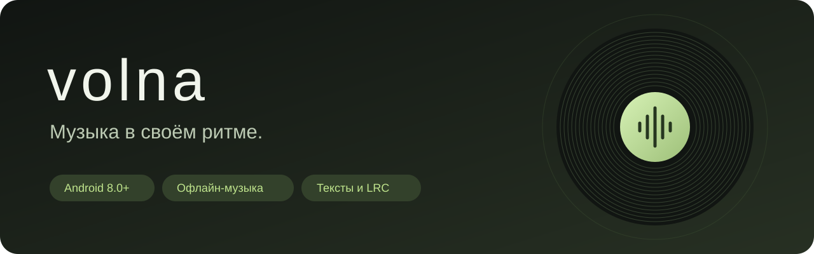

<p align="center">
  
</p>

<p align="center">
  <strong>Локальная музыка. Тексты песен. Оформление в цветах обложки.</strong>
</p>

<p align="center">
  <a href="https://github.com/fixeemixee-droid/volna/releases/tag/v1.3">Скачать APK</a> ·
  <a href="#возможности">Возможности</a> ·
  <a href="#сборка">Сборка</a>
</p>

---

**Volna** — музыкальный плеер для Android с русским интерфейсом. Добавляйте треки с устройства, слушайте их без интернета, открывайте сохранённые тексты и настройте приложение под себя.

| | |
|---|---|
| Текущая версия | **1.3**, тестовая сборка |
| Платформа | Android **8.0+**, API 26+ |
| Язык реализации | Java |
| Музыка и сохранённые тексты | Работают офлайн |
| Поиск новых текстов | Интернет, сервис LRCLIB |

## Установка

1. Откройте [релиз Volna 1.3](https://github.com/fixeemixee-droid/volna/releases/tag/v1.3).
2. Скачайте файл **`volna-1.3.apk`** из раздела Assets.
3. Откройте APK на телефоне. Если Android запросит разрешение на установку из этого источника, предоставьте его для выбранного браузера или файлового менеджера.
4. Во вкладке **«Загрузить»** выберите один или несколько аудиофайлов.

Файлы копируются во внутреннее хранилище приложения. При обновлении поверх установленной версии данные сохраняются, если пакет и ключ подписи совместимы. Удаление приложения или очистка его данных удаляет локальную библиотеку, обложки, фоны и сохранённые тексты.

> Сборка проверялась в эмуляторе Android 15. Возможности кодеков, аудиоэффектов и фоновой работы зависят от устройства.

## Возможности

### Слушать

- Компактная карточка плеера по центру экрана.
- Пауза, следующий и предыдущий трек, случайный трек и повтор одной записи.
- Перемотка и ползунки с полностью видимыми круглыми индикаторами по краям шкалы.
- Фоновое воспроизведение, управление из уведомления и с экрана блокировки.
- Таймер сна с остановкой музыки и закрытием экрана приложения.
- Стерео и настоящее моно для одного уха, включая вывод только в левый или правый наушник.

### Библиотека

- Загрузка нескольких файлов через системный проводник.
- Локальное хранение, поиск и выбор трека для воспроизведения.
- Изменение названия и исполнителя.
- Собственная обложка и сведения об аудиофайле.

Форматы зависят от кодеков Android: например, MP3, WAV, M4A, FLAC и OGG.

### Тексты и субтитры

1. В библиотеке откройте **⋮ → «Название, исполнитель и автопоиск текста»**.
2. Укажите название и, желательно, исполнителя.
3. Нажмите **«Сохранить и найти»**.

Результаты LRCLIB открываются внутри приложения. Точное совпадение сохраняется автоматически. Если найдено несколько подходящих записей, можно выбрать нужную версию вручную.

Кнопка **«Субтитры»** в плеере открывает сохранённый текст:

- при наличии LRC-меток текущая строка подсвечивается по позиции записи;
- следование за строкой можно отключить;
- сдвиг времени меняется шагами по 0.5 секунды;
- обычный текст показывается без искусственной синхронизации;
- собственный текст или LRC можно вставить вручную.

Сохранённые тексты доступны без интернета. Это поиск готовых текстов, а не распознавание речи или генерация субтитров из аудио. Доступность текста и точность совпадения зависят от базы LRCLIB.

### Оформление

- Семь тем, включая светлые и тёмные варианты и тему по обложке.
- Настройка фона, карточек и акцента через RGB или HEX.
- Собственные фоны и их затемнение.
- Применение оформления ко всему приложению, выбранным разделам или только карточке плеера.
- Адаптивная палитра с настройкой насыщенности, светлоты и силы эффекта.
- Градиент карточки по двум оттенкам обложки: интенсивность и три направления.
- Плавные переходы и вращение пластинки с возможностью отключения.

Градиент находится в **«Настройки → Оформление → Градиент карточки по обложке»**. Если обложки нет, используется цвет темы.

### Звук и приложение

Громкость, скорость, высота тона, баланс, эквалайзер, усиление, автоматический переход к следующей записи, пауза при отключении наушников, запоминание трека и сохранение экрана включённым.

## Приватность и интернет

Музыкальные файлы не отправляются в LRCLIB. Для поиска используются название, исполнитель, альбом и длительность. Тексты сохраняются на устройстве.

Приложению нужен интернет для загрузки новых текстов. Обычное прослушивание и чтение сохранённого текста не требуют сети. У стороннего сервиса есть собственные ограничения и правила обработки запросов.

Источник текстов: [LRCLIB](https://lrclib.net/) · [документация API](https://lrclib.net/docs). Volna не является официальным приложением LRCLIB.

## Сборка

Инструкция относится к Android-проекту со скриптом `build-apk.sh` в корне.

Понадобятся:

- JDK 17;
- Android SDK Platform 35;
- Android SDK Build Tools 35.0.0;
- Bash, Python 3 и утилита `zip` для сборки скриптом в Linux/macOS.

```bash
export JAVA_HOME=/path/to/jdk17
export ANDROID_SDK_ROOT=/path/to/android-sdk
chmod +x build-apk.sh
./build-apk.sh
```

Результат: **`build/volna-android.apk`**.

Скрипт создаёт тестовый APK. Для публичных обновлений используйте собственный постоянный ключ подписи и храните его вне Git. Подробности о публикации и подписи — в [инструкции для владельца](docs/PUBLISH.md).

## Проверка

Версия 1.3 проверялась в эмуляторе Android 15: разметка, сохранение текста, офлайн-кэш, LRC-синхронизация, неоднозначные совпадения и градиент. Сценарий автоматического поиска использовал контролируемый ответ; доступность API проверялась отдельно. На реальном телефоне поведение кодеков, аудиоэффектов и энергосбережения может отличаться.

[История изменений](CHANGELOG.md).

## Лицензия

Исходный код распространяется по лицензии [MIT](LICENSE).

Тексты песен и внешние данные не становятся собственностью проекта и не получают лицензию кода автоматически.
